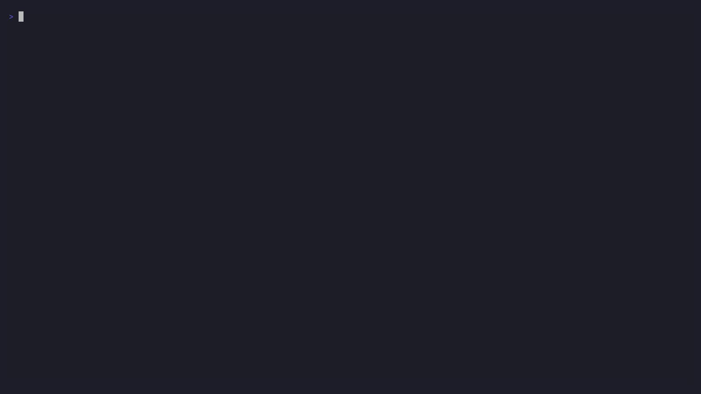
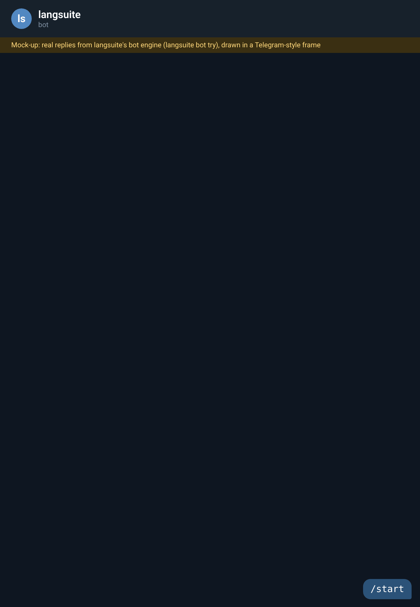

# langsuite

[](https://pypi.org/project/langsuite/) [](https://github.com/ao3575911/langsuite/actions/workflows/ci.yml) [](https://ao3575911.github.io/langsuite/)

A research knowledge base of programming languages, with a CLI, a Textual app and a Telegram bot. Every fact links to its source.



## Install

```sh
pipx install langsuite        # or: uv tool install langsuite
langsuite base build          # PLDB + Linguist, about 11 MB
langsuite                     # opens the app; `langsuite --help` for the CLI
```

You need Python 3.12 or newer. Docker is optional and only used by `verify`. To install from source: `git clone https://github.com/ao3575911/langsuite && cd langsuite && uv sync`.

## What it does

Every command in this table runs as written once `base build` has finished.

| | Command | Evidence |
|---|---|---|
| Sourced facts | `langsuite lang show haskell --evidence` | Each fact carries its source, URL and retrieval time (PLDB, Linguist). |
| Query | `langsuite query "macros top=3"` | Same DSL in the CLI, the Query pane and `/q` in the bot. |
| Similarity | `langsuite similar haskell` | Rarity-weighted Jaccard with a z-score against 1,000 shuffles. |
| Scores | `langsuite rank --top 5` | Points per criterion; a missing criterion lowers confidence and never counts as zero. |
| Verified code | `langsuite verify main.rs` | Runs in a digest-pinned, offline Docker sandbox (20 toolchains). |
| Official docs | `langsuite docs search "unpacking"` | Exact quotes with a link, version and anchor. |
| Signed data | `langsuite base pull URL --key cosign.pub` | Refuses unsigned or tampered snapshots (cosign-compatible). |
| Workspaces | `langsuite finding save similar scheme` | Findings re-run bit-for-bit on their pinned snapshot. |
| Plan and quota | `langsuite usage` | Shows the monthly quota and exits with code 5 at 100%. |

## Telegram bot



*The bot GIF is a mock-up. The replies are real output from langsuite's bot engine (`langsuite bot try`), drawn in a Telegram-style frame. It is not a screen recording of Telegram.*

`langsuite bot run` serves the same commands and aliases as the CLI. Each chat gets its own workspace, with roles, rate limits and daily digests.

## Status

**1.0.0 release candidate.** Milestones M0 to M5i are built, with M5i on the client side only. The hosted service (tenants, sync, backups) is not deployed. Not yet published to PyPI: publishing runs from a signed `v*` tag ([docs/RELEASING.md](RELEASING.md)).

Not done yet: [open questions](OPEN_QUESTIONS.md) and [issues](https://github.com/ao3575911/langsuite/issues).

## More

[Wiki](https://github.com/ao3575911/langsuite/wiki) · [Full guide](guide.md) · [Spec](SPEC.md) · [Changelog](https://github.com/ao3575911/langsuite/blob/main/CHANGELOG.md) · [Discussions](https://github.com/ao3575911/langsuite/discussions) · Licence: see [LICENSE](https://github.com/ao3575911/langsuite/blob/main/LICENSE)
